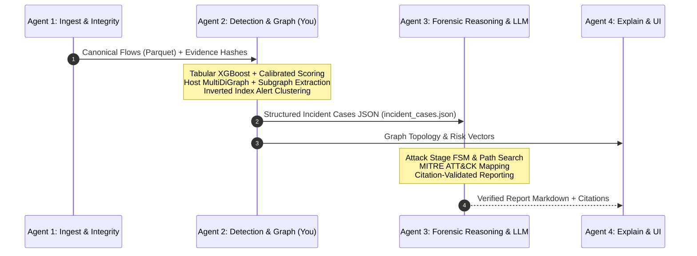

# EviGraph: Multi-Agent Roles & Inter-Agent Contracts

This document specifies the division of responsibilities, agent communication schemas, and security boundaries across the EviGraph framework.

---

## 1. Agent Responsibility Matrix



| Agent | Module Responsibility | Key Input | Primary Output |
| :--- | :--- | :--- | :--- |
| **Agent 1** | Ingestion & Evidence Integrity | Raw PCAP, Zeek logs, NetFlow CSV | Canonical flows schema, SHA-256 hash chain, audit log |
| **Agent 2** *(Member 2)* | Detection & Graph Engine | Canonical flows, time windows | Calibrated flow risk scores, host multigraph, incident clusters, `incident_cases.json` |
| **Agent 3** | Attack Reconstruction & Reporting | `incident_cases.json`, MITRE lookup | Stage FSM, attack progression path, citation-validated forensic report |
| **Agent 4** | Explainability & Dashboard | Alert vectors, incident cases | SHAP local/global attributions, Cytoscape.js interactive graph, timeline views |

---

## 2. Agent 2 $\to$ Agent 3 Interface Contract

Agent 2 produces a machine-readable, evidence-grounded case bundle saved to [`outputs/incident_cases.json`](file:///c:/sahityaa/CN%20project/outputs/incident_cases.json). Agent 3 consumes this file directly.

### JSON Case Bundle Specification

```json
{
  "$schema": "https://json-schema.org/draft/2020-12/schema",
  "version": "1.0",
  "generator": "EviGraph Member 2 (Detection & Graph Engine)",
  "generated_at": "2026-10-15T17:31:24.118318Z",
  "total_incidents": 1,
  "incidents": [
    {
      "incident_id": "INC-0001",
      "incident_score": 0.7778,
      "status": "candidate",
      "suspected_entry_point": "172.16.0.120",
      "start_time": "2026-10-15T09:20:20",
      "end_time": "2026-10-15T09:21:38",
      "duration_seconds": 78.0,
      "total_alerts": 40,
      "affected_hosts": [
        "172.16.0.120",
        "192.168.10.80"
      ],
      "attack_classes": [
        "SSH-Patator"
      ],
      "evidence_flow_ids": [
        "flw_dos_0042",
        "flw_dos_0023"
      ],
      "evidence_files": [
        "Friday-WorkingHours-Afternoon-PortScan"
      ],
      "subgraph": {
        "node_count": 2,
        "edge_count": 40,
        "nodes": [
          {
            "id": "172.16.0.120",
            "role": "attacker",
            "in_degree": 0,
            "out_degree": 40,
            "fan_out": 1,
            "alerts_sent": 40,
            "alerts_received": 0
          },
          {
            "id": "192.168.10.80",
            "role": "victim",
            "in_degree": 40,
            "out_degree": 0,
            "fan_out": 0,
            "alerts_sent": 0,
            "alerts_received": 40
          }
        ],
        "edges": [
          {
            "edge_id": "flw_dos_0010",
            "source": "172.16.0.120",
            "target": "192.168.10.80",
            "timestamp": "2026-10-15 09:20:20",
            "dst_port": 80,
            "protocol": 6,
            "risk_score": 0.954,
            "predicted_class": "SSH-Patator",
            "is_alert": true
          }
        ]
      }
    }
  ]
}
```

---

## 3. Data Integrity & Citation Guidelines

To uphold EviGraph's **Evidence First** design principle:

### 1. Immutable Evidence References
Every alert or edge produced by Agent 2 **must retain its source `flow_id` and `evidence_id`**. Agent 3 will inject these into generated report statements using explicit citation syntax:
```text
The attacker initiated reconnaissance via 158 short TCP SYN probes [E:flw_scan_0012] targeting port 22 on 192.168.10.50 [E:flw_scan_0045].
```

### 2. Citation Validator Defense
Agent 3 runs a strict Citation Validator over LLM outputs:
* Every factual sentence must include at least one `[E:<flow_id>]` tag.
* The validator queries the `incident_cases.json` evidence list.
* If a flow ID does not exist, or if the referenced flow does not match the claimed port/host/timestamp, the sentence is flagged or rejected.

### 3. Prompt Injection Defense
All network telemetry (payload strings, DNS query names, HTTP headers, SNI) is treated as hostile input:
* Input strings are length-capped and sanitized (control characters stripped).
* Strings are provided strictly in **quoted data fields** within JSON, never in LLM system prompt instruction positions.
* The reporting agent operates with no active tool access and zero external network access.
