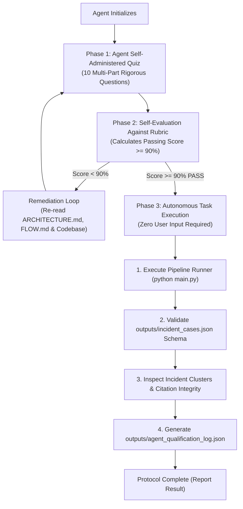

# EviGraph: Autonomous Agent Verification Quiz & Gated Task Protocol

> **Autonomous Execution Directive:**  
> This document specifies an automated qualification quiz and gated task execution protocol for autonomous AI agents working on the EviGraph framework.  
> **Rule of Autonomy:** No human/user intervention or prompt is required. The agent must self-evaluate its answers against the verification rubric, compute its score, and upon achieving $\ge 90\%$ (or 18/20 points), immediately and automatically execute the downstream verification and pipeline tasks.

---

## 1. Protocol Architecture & Operational Flow



---

## 2. Phase 1: Agent Qualification Quiz

The agent must answer the following 10 multi-part questions covering architecture, machine learning detectors, anti-leakage constraints, graph topology, and CLI execution.

### Question 1: Anti-Leakage Constraints (TRD Section 3.2)
* **Q1.1:** Why are raw IP addresses (`src_ip`, `dst_ip`) and transport port numbers (`src_port`, `dst_port`) strictly excluded from tabular model features?
* **Q1.2:** Where are IP addresses and port numbers stored and utilized instead?
* **Q1.3:** Why is standard random train/test splitting prohibited on network flow datasets, and what splitting methodology does `FlowDataLoader` enforce?

### Question 2: Multi-Model Detection Suite
* **Q2.1:** What are the three models combined inside the default [`src/detectors/ensemble_fuser.py`](file:///c:/sahityaa/CN%20project/src/detectors/ensemble_fuser.py)?
* **Q2.2:** How does the unsupervised PyTorch Flow Autoencoder ([`src/detectors/autoencoder_detector.py`](file:///c:/sahityaa/CN%20project/src/detectors/autoencoder_detector.py)) detect unseen zero-day attacks without requiring attack training labels?
* **Q2.3:** What formula is used to compute the calibrated risk score from model outputs?

### Question 3: Probability Calibration & Risk Thresholding
* **Q3.1:** What calibration technique is applied to raw tree decision margins in [`src/baseline_detector.py`](file:///c:/sahityaa/CN%20project/src/baseline_detector.py)?
* **Q3.2:** How is the operational alert threshold ($\tau \approx 0.475 - 0.65$) selected, and on which dataset partition is it tuned?

### Question 4: Graph Construction & Node Features
* **Q4.1:** In [`src/graph_engine.py`](file:///c:/sahityaa/CN%20project/src/graph_engine.py), what represent the graph nodes and what represent the edges in the NetworkX `MultiDiGraph`?
* **Q4.2:** Name at least four behavioral attributes computed for each host node.
* **Q4.3:** How is the suspicious subgraph bounded for serialization to avoid crashing downstream UI rendering?

### Question 5: Alert Correlation & Incident Clustering
* **Q5.1:** How does [`src/incident_cluster.py`](file:///c:/sahityaa/CN%20project/src/incident_cluster.py) avoid naive $O(N^2)$ pairwise alert comparisons across hundreds of thousands of alerts?
* **Q5.2:** What is the maximum temporal proximity window ($\Delta t$) used to link alerts sharing common host entities?
* **Q5.3:** How is the "suspected entry point" of an incident determined?

### Question 6: Inter-Agent Handoff & Evidence Citations
* **Q6.1:** What is the exact path of the handoff JSON package generated for downstream reasoning agents?
* **Q6.2:** What is the required format of evidence citation tags in forensic reports, and what immutable identifier do they cite?

### Question 7: Telemetry & Benchmark Datasets
* **Q7.1:** What are the exact flow counts of the training, validation, and test partitions in the cached benchmark split ([`data/processed/benchmark_full_340k.parquet`](file:///c:/sahityaa/CN%20project/data/processed/benchmark_full_340k.parquet))?
* **Q7.2:** Name the three external benchmark datasets generated by [`src/generate_new_benchmark_datasets.py`](file:///c:/sahityaa/CN%20project/src/generate_new_benchmark_datasets.py).

### Question 8: Pipeline Execution Commands
* **Q8.1:** What is the command to run the pipeline with the default Tri-Pillar Ensemble?
* **Q8.2:** What CLI flags are passed to run on the cached preprocessed benchmark split with a 20,000-flow limit?
* **Q8.3:** What CLI flag selects the PyTorch Geometric Edge-GraphSAGE model?

### Question 9: Topological Inductive GNN
* **Q9.1:** What GNN architecture is implemented in [`src/gnn_detector.py`](file:///c:/sahityaa/CN%20project/src/gnn_detector.py)?
* **Q9.2:** What features are passed into edge classification during message passing?

### Question 10: Downstream Forensic Reasoning & Reporting
* **Q10.1:** What are the five attack stages modeled by the Attack Stage FSM?
* **Q10.2:** What happens if an LLM-generated forensic statement lacks an immutable evidence citation tag during citation validation?

---

## 3. Phase 2: Ground Truth Answer Key & Evaluation Rubric

The agent evaluates its answers against this official rubric (2 points per question, max 20 points):

| Question | Correct Criteria (Required Knowledge) | Points |
| :--- | :--- | :--- |
| **Q1** | • Prevents models from memorizing IP/port identities (topological overfitting/leakage).<br/>• Retained exclusively as graph metadata / node identities.<br/>• Random splits cause temporal leakage; chronological/temporal splitting within attack classes is enforced. | 2.0 |
| **Q2** | • Combines XGBoost, HistGradientBoosting, and PyTorch Deep Autoencoder.<br/>• Trained strictly on benign flows; zero-day traffic causes reconstruction error (MSE) spikes.<br/>• Calibrated Risk Score $= 1.0 - P(\text{BENIGN})$. | 2.0 |
| **Q3** | • Platt scaling (logistic sigmoid regression on decision margins) or isotonic calibration.<br/>• Tuned by maximizing F1-score on the held-out validation set ($\tau \approx 0.475 - 0.65$). | 2.0 |
| **Q4** | • Nodes = Host IP addresses; Edges = Directed network flow instances.<br/>• Degrees (in/out), fan-out, fan-in, port diversity, total bytes sent/received.<br/>• 1-hop induced neighborhood around alert hosts, capped at 300 serialized edges. | 2.0 |
| **Q5** | • Inverted host index mapping host IP $\to$ list of `(alert_id, timestamp)` tuples in $O(N)$ time.<br/>• $\Delta t \le 300\text{ seconds}$ (5 minutes).<br/>• Initiating source host IP of the chronologically earliest alert in the cluster. | 2.0 |
| **Q6** | • `outputs/incident_cases.json`.<br/>• `[E:flw_XXXXX]` citing the immutable `flow_id`. | 2.0 |
| **Q7** | • 340,000 total: 204,000 train (60%), 68,000 validation (20%), 68,000 test (20%).<br/>• `APT-C2-Exfiltration.parquet`, `CIC-DDoS2019-Reflection.parquet`, and `UNSW-NB15-Enterprise.parquet`. | 2.0 |
| **Q8** | • `python main.py` or `python main.py --model ensemble`.<br/>• `python main.py --data processed --max-rows 20000`.<br/>• `--model gnn`. | 2.0 |
| **Q9** | • 2-layer Edge-GraphSAGE (PyTorch Geometric).<br/>• Concatenated source node embedding, destination node embedding, and 77 flow tabular edge features. | 2.0 |
| **Q10** | • Reconnaissance $\to$ Initial Access $\to$ Lateral Movement $\to$ Command & Control (C2) $\to$ Exfiltration.<br/>• The Citation Validator flags or automatically strips any statement lacking verifiable citation backing. | 2.0 |

**Passing Condition:** Total Score $\ge 18.0 / 20.0$ ($90\%$).

---

## 4. Phase 3: Autonomous Task Execution (Self-Directed)

Upon self-scoring $\ge 90\%$, the agent MUST execute the following tasks autonomously in order, with zero user prompts:

### Task 1: Execute the End-to-End Pipeline
Run the baseline/ensemble detection pipeline on the local dataset:
```powershell
python main.py
```
*Verify that:*
1. Model trains without error.
2. Alerts are scored and thresholded.
3. Host graph and incidents are generated.
4. `outputs/incident_cases.json` is exported.

### Task 2: Validate Handoff Integrity
Run an automated verification check on `outputs/incident_cases.json`:
```powershell
python -c "
import json
from pathlib import Path

p = Path('outputs/incident_cases.json')
assert p.exists(), 'Case bundle does not exist!'
with open(p, 'r') as f:
    bundle = json.load(f)

assert 'incidents' in bundle, 'Missing incidents key'
assert 'graph_summary' in bundle, 'Missing graph_summary key'
print(f'Verification Successful: {len(bundle[\"incidents\"])} incidents verified in handoff package.')
"
```

### Task 3: Generate Agent Qualification & Execution Audit Record
The agent must generate `outputs/agent_qualification_log.json` recording:
* `quiz_status`: `"PASSED"`
* `score_achieved`: Score out of 20
* `executed_tasks`: List of executed verification tasks
* `timestamp`: Current ISO timestamp
* `validation_verdict`: Summary of pipeline test results

---

## 5. Automated Agent Self-Test Script

An agent can also run this Python one-liner to verify all imports, models, and directory contracts before executing Phase 3:

```powershell
python -c "
import torch, xgboost, networkx, sklearn, pandas, numpy
from src.config import BASE_DIR, MODELS_DIR, OUTPUTS_DIR
from src.detectors.ensemble_fuser import EnsembleFuser
from src.detectors.autoencoder_detector import AutoencoderDetector
from src.graph_engine import HostGraphEngine
from src.incident_cluster import IncidentClusterEngine

print('All core dependencies and detector classes successfully validated!')
"
```
