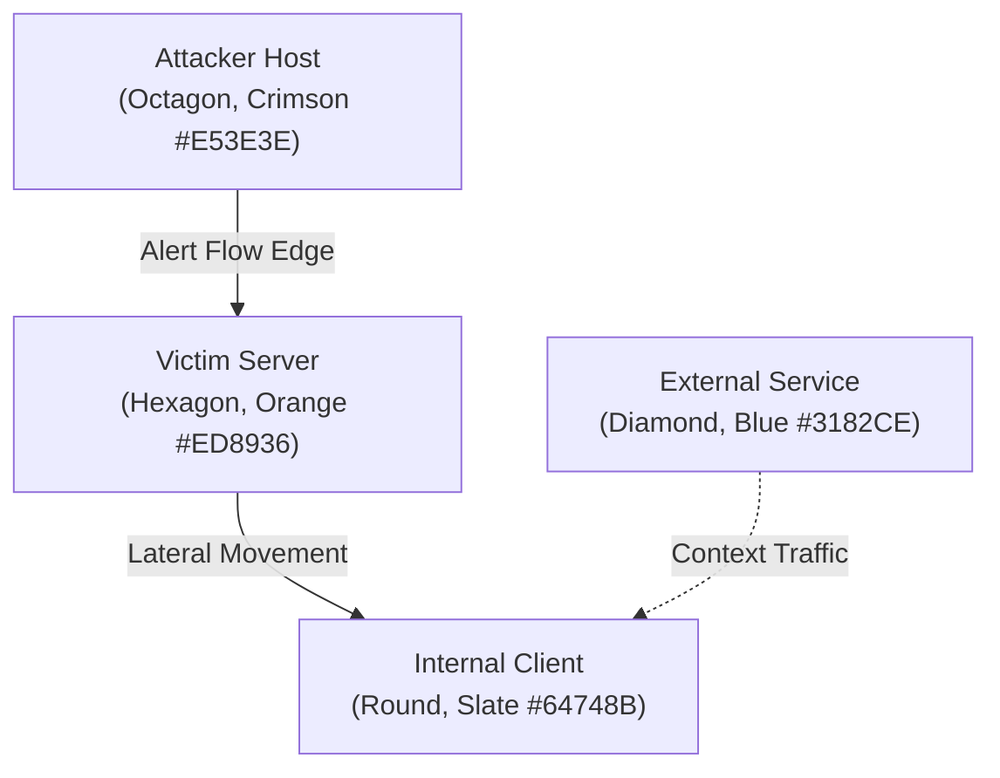

# EviGraph: Forensic Dashboard & Graph Design System

**Version:** 1.0 | **Target Interfaces:** Cytoscape.js, Streamlit / Plotly Dash / React

---

## 1. Design Philosophy: Evidence-First UI

The EviGraph Design System is built specifically for security operations (SOC) and digital forensics investigators:
1. **Zero-Click Context:** Key incident severity, entry point, and affected host counts are visible immediately.
2. **3-Click Evidence Rule (PRD NFR-8):** An investigator can drill down from high-level incident summary $\to$ suspicious graph edge $\to$ underlying raw packet/flow record in $\le 3$ clicks.
3. **High-Contrast Dark Theme:** Optimized for multi-monitor SOC watchfloors to reduce eye fatigue.

---

## 2. Color System & Severity Tokens

### 2.1 Threat & Risk Palette

| Severity Token | Hex Code | Visual Swatch | Applied Context |
| :--- | :--- | :--- | :--- |
| **Critical Risk** | `#E53E3E` | <span style="color:#E53E3E;">■</span> Red | Risk score $\ge 0.85$, confirmed exploits, C2 beaconing |
| **High Risk** | `#ED8936` | <span style="color:#ED8936;">■</span> Orange | Risk score $0.65 - 0.84$, active scans, brute force |
| **Medium / Warning**| `#ECC94B` | <span style="color:#ECC94B;">■</span> Yellow | Risk score $0.40 - 0.64$, unusual protocol fan-out |
| **Benign / Normal** | `#38A169` | <span style="color:#38A169;">■</span> Green | Risk score $< 0.40$, regular enterprise traffic |
| **External / Neutral**| `#3182CE` | <span style="color:#3182CE;">■</span> Blue | Public DNS, legitimate cloud infrastructure |

### 2.2 Surface & Neutral Tokens (Dark SOC Mode)
* **Canvas Background:** `#0B0F19` (Deep Obsidian)
* **Card & Surface Background:** `#1E293B` (Slate 800)
* **Surface Highlight / Hover:** `#334155` (Slate 700)
* **Borders & Separators:** `#475569` (Slate 600)
* **Primary Text:** `#F8FAFC` (High-contrast Off-White)
* **Secondary / Muted Text:** `#94A3B8` (Slate 400)
* **Code / Hash Text:** `#38BDF8` (Sky Blue)

---

## 3. Cytoscape.js Forensic Graph Specifications

The host-communication multigraph visualization maps network topologies and suspicious subgraphs as follows:

### 3.1 Node Definitions



| Node Role | Shape | Border Color | Fill Color | Size | Notes |
| :--- | :--- | :--- | :--- | :--- | :--- |
| **Attacker / Entry Point** | `octagon` | `#E53E3E` (Red) | `#742A2A` | 48px | Displays warning icon, pulsing border |
| **Victim Server** | `hexagon` | `#ED8936` (Orange) | `#7B341E` | 44px | High in-degree, targeted ports |
| **Internal Workstation** | `ellipse` | `#64748B` (Slate) | `#1E293B` | 32px | Default internal host |
| **External Gateway / DNS** | `diamond` | `#3182CE` (Blue) | `#1A365D` | 36px | External public IP address |

### 3.2 Edge Definitions
* **Alert Flows (High Risk):**
  * Color: `#E53E3E` (Red)
  * Line Style: Solid directed arrow with width $W = \max(2, \min(8, \log_{10}(\text{bytes})))$.
  * Active Selection: Animated neon glow outline.
* **Context / Benign Flows:**
  * Color: `#475569` (Muted Slate)
  * Opacity: `0.35`
  * Line Style: Thin directed line ($1\text{px}$).

---

## 4. Dashboard Layout & Component Hierarchy

The forensic interface is structured into four synchronized panes:

```
+-------------------------------------------------------------------------------+
| EVIGRAPH FORENSIC WORKBENCH               [Run: 20261015] [Audit Hash: 9f4a..] |
+-------------------------------------------------------------------------------+
| [1] INCIDENT TRIAGE LIST   | [2] INTERACTIVE ATTACK GRAPH (Cytoscape.js)       |
| Ranked by Severity Score   | - Node: Hosts (Attacker, Victim, Gateway)        |
|                            | - Edge: Color-coded flows with risk score        |
| > INC-0001 (Score: 0.88)   | - Filters: Time window slider, port filter       |
|   PortScan -> SSH Brute    |                                                  |
|   Hosts: 172.16.0 -> .50   +--------------------------------------------------+
|                            | [3] ATTACK STAGE TIMELINE (FSM Reconstruction)   |
|   INC-0002 (Score: 0.65)   | [Reconnaissance] -> [Initial Access] -> [C2]    |
|   DoS Slowloris            |  09:10 - 09:12       09:13 - 09:17       09:20    |
+-------------------------------------------------------------------------------+
| [4] EVIDENCE INSPECTOR & VERIFIED CITATIONS                                   |
| Clicked Edge: flw_001928 | Src: 172.16.0.105:49152 -> Dst: 192.168.10.50:22  |
| Calibrated Risk: 0.954   | Predicted: SSH-Patator | Packets: 22 | Bytes: 1820 |
| Verified Statement: "Attacker attempted 40 consecutive logins to port 22 [E:flw_001928]" |
+-------------------------------------------------------------------------------+
```

---

## 5. Typography & Formatting Standards

* **UI Display Font:** `Inter`, `-apple-system`, `sans-serif` (weight: 400 for prose, 600 for headers).
* **Forensic Data & Code Font:** `JetBrains Mono`, `Consolas`, `monospace`.
  * Used for: IPv4/IPv6 addresses, MAC addresses, SHA-256 hashes, flow IDs (`flw_XXXXX`), and ports.
* **Evidence Citation Badges:**
  * Rendered as: `[E:flw_XXXXX]` in `#38BDF8` with a rounded pill background (`rgba(56, 189, 248, 0.15)`).
  * Hovering over the badge highlights the corresponding edge on the attack graph.
  * Clicking the badge opens the raw flow attribute drawer.
