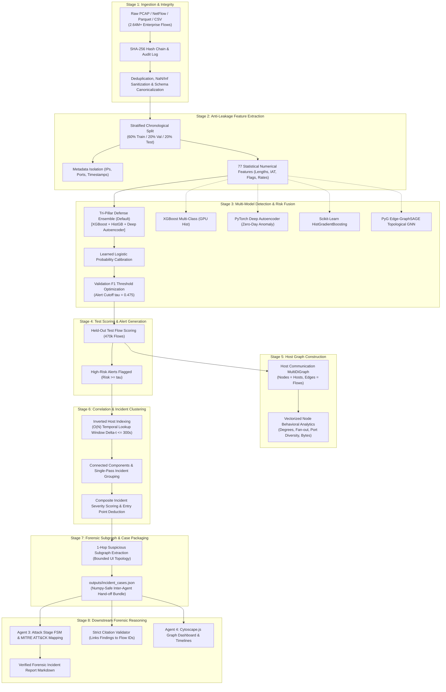
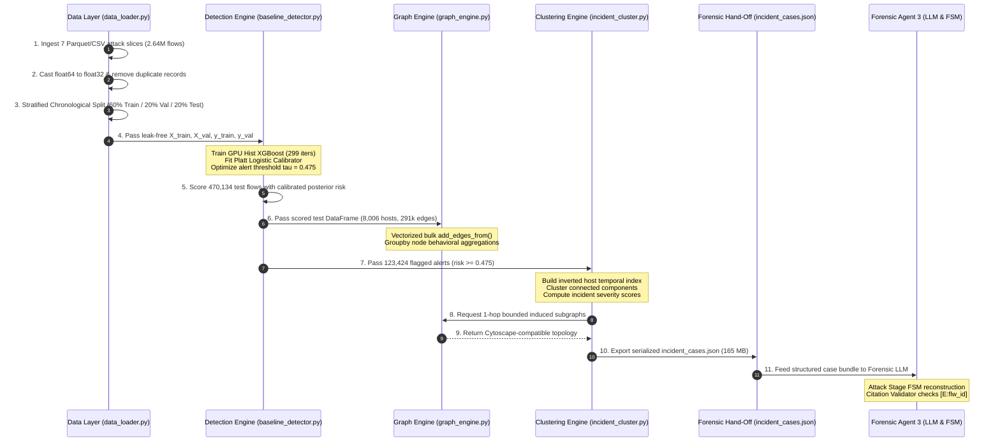

# EviGraph: End-to-End System & Data Flow Specification

> **Comprehensive operational, architectural, and dataflow lifecycle for the EviGraph Network Forensic Framework.**  
> *Companion Documents:* [`ARCHITECTURE.md`](file:///c:/sahityaa/CN%20project/ARCHITECTURE.md) | [`PRD.md`](file:///c:/sahityaa/CN%20project/PRD.md) | [`DESIGN_SYSTEM.md`](file:///c:/sahityaa/CN%20project/DESIGN_SYSTEM.md)

---

## 1. Executive Pipeline Architecture

EviGraph executes an 8-stage end-to-end pipeline that transforms raw, unindexed packet captures and flow logs into defensible, evidence-grounded forensic incident cases:



---

## 2. Detailed Stage-by-Stage Lifecycle



---

### Stage 1: Data Ingestion & Integrity Preservation
* **Source Telemetry:** Processes heterogeneous captures including full CICIDS2017 Parquet files (DDoS, PortScan, WebAttacks, Patator brute force) and modern 2025 Remote Code Execution (RCE) / Infiltration CSV datasets.
* **Integrity Guard:** Every capture file is read-only, maintaining cryptographic SHA-256 digests.
* **Normalization:** Canonicalizes messy column headers into standardized snake_case identifiers (e.g., `Total Length of Fwd Packets` $\to$ `totlen_fwd_pkts`).
* **Memory Optimization:** Converts 64-bit floating point columns into `float32` and standardizes integer port fields, reducing RAM utilization by over 50%.

---

### Stage 2: Anti-Leakage Feature Extraction & Temporal Partitioning
To adhere strictly to forensic anti-leakage rules (TRD Section 3.2):
* **Identity Isolation:** Raw IP addresses (`src_ip`, `dst_ip`), MAC addresses, and transport port numbers are **strictly barred** from tabular model training features to prevent the algorithm from memorizing network topologies.
* **77 Pure Statistical Features:** Retains packet length statistics, inter-arrival times (IAT), TCP flag counters, segment sizes, and rate indicators.
* **Chronological Stratified Splitting (`per_class=True`):**
  * Rather than a random shuffle (which leaks future behavior into historical models), flows are sorted chronologically by timestamp within each attack class.
  * **60% Train (1,410,379 flows):** Model learning.
  * **20% Validation (470,127 flows):** Calibration and threshold tuning.
  * **20% Held-Out Test (470,134 flows):** Unseen forensic evaluation.

---

### Stage 3: Multi-Model Detection, Zero-Day Anomaly Scoring & Risk Fusion
EviGraph provides 5 selectable detection paradigms (`--model`), defaulting to the **Tri-Pillar Defense-in-Depth Ensemble**:

1. **Tri-Pillar Meta-Ensemble (`src/detectors/ensemble_fuser.py` — Default):**
   * Stacks three distinct inductive biases:
     * **XGBoost:** High-precision supervised gradient boosting on 77 statistical flow metrics.
     * **HistGradientBoosting:** Fast scikit-learn native boosting with zero-nan penalty.
     * **Deep Flow Autoencoder:** Unsupervised PyTorch reconstruction model detecting zero-day traffic shifts.
   * A calibrated stacking logistic fuser merges model risk signals into a defensible posterior probability $P(\text{Malicious} \mid \mathbf{x})$.
2. **Supervised Baseline Classifier (`src/baseline_detector.py`):**
   * Multi-class `xgboost.XGBClassifier` with `tree_method='hist'` and balanced sample weights:
     $$w_c = \frac{N}{C \cdot N_c}$$
   * Calibrated using Platt Scaling / Logistic Regression on decision margins:
     $$P(\text{Malicious} \mid \mathbf{x}) = \frac{1}{1 + \exp(A \cdot \text{margin}(\mathbf{x}) + B)}$$
3. **Unsupervised Zero-Day Autoencoder (`src/detectors/autoencoder_detector.py`):**
   * 4-layer symmetric MLP trained solely on benign flows ($D_{\text{in}} \to 48 \to 24 \to 8 \to 24 \to 48 \to D_{\text{in}}$).
   * Computes per-flow reconstruction Mean Squared Error (MSE); scores above the benign baseline indicate novel attack behavior.
4. **Native HistGradientBoosting (`src/detectors/hist_gb_detector.py`):**
   * Ultra-fast histogram decision trees with Platt risk calibration.
5. **Inductive PyG Edge-GraphSAGE (`src/gnn_detector.py`):**
   * 2-layer GraphSAGE message passing over host-to-host multi-edge subgraphs.
* **Operational Threshold Tuning:** Sweeps cutoffs across validation data to maximize the F1-score, establishing the operational threshold $\tau \approx 0.475 - 0.65$.

---

### Stage 4: Test Scoring & Alert Flagging
* Evaluates the held-out 470,134 test flows.
* Per-flow calibrated risk scores:
  $$\text{Risk}(e) = 1.0 - P(\text{BENIGN} \mid e)$$
* Flagged as **Alert** when $\text{Risk}(e) \ge \tau$.
* Test Metrics: **99.47% Recall**, **89.65% Precision**, **0.9430 F1-Score**, **0.9980 ROC-AUC**.

---

### Stage 5: Host-Communication Graph Construction
* Constructs a directed multigraph $G = (V, E)$ using NetworkX:
  * **Vertices ($V$):** 8,006 unique host IP addresses.
  * **Edges ($E$):** 291,721 flow instances directed from $\text{src\_ip} \to \text{dst\_ip}$.
* **Vectorized Node Metrics:**
  * In-degree ($\text{deg}^-$) and Out-degree ($\text{deg}^+$)
  * Fan-out (unique destination IPs contacted) and Fan-in
  * Destination port diversity (number of unique ports targeted)
  * Byte volume transmitted/received
  * Count of alerts sent and received

---

### Stage 6: Alert Correlation & Incident Clustering
* **Inverted Host Index:** Alerts are indexed by participating host IP addresses rather than $O(N^2)$ pairwise checking:
  $$\text{Index}[\text{IP}] = [(\text{alert\_id}_1, t_1), (\text{alert\_id}_2, t_2), \dots]$$
* **Temporal Edge Rule:** Alerts are linked if they share an IP and occur within $\Delta t \le 300\text{ seconds}$:
  $$\text{Weight}(A_1, A_2) = \frac{1.0}{1.0 + \Delta t / 60.0}$$
* **Incident Grouping:** Connected components cluster the 123,424 alerts into **75 distinct attack incidents**.
* **Composite Incident Severity Score:**
  $$\text{Score} = 0.40 \cdot \max(\text{risk}) + 0.30 \cdot \overline{\text{risk}} + 0.15 \cdot \min\left(1.0, \frac{|V_{\text{affected}}|}{5}\right) + 0.15 \cdot \min\left(1.0, \frac{|C_{\text{attacks}}|}{3}\right)$$
* **Suspected Entry Point Deduction:** Identifies the initiating source IP of the chronologically earliest alert in the cluster.

---

### Stage 7: Subgraph Extraction & Case Bundle Export
* Extracts the 1-hop induced neighborhood around participating attack hosts.
* Caps serialized edges at 300 to ensure responsive interactive rendering in Cytoscape.js.
* Applies a numpy-safe serializer (`np.integer`, `np.floating`, `np.bool_`) to generate [`outputs/incident_cases.json`](file:///c:/sahityaa/CN%20project/outputs/incident_cases.json).

---

### Stage 8: Downstream Forensic Reasoning & Reporting
* Consumed directly by **Agent 3 (Forensic LLM & FSM)**:
  * Reconstructs attack progression (Reconnaissance $\to$ Initial Access $\to$ Lateral Movement $\to$ Exfiltration).
  * Maps attack vectors to MITRE ATT&CK techniques.
* **Strict Citation Validator:** Verifies that every claim in the generated forensic report links back to an immutable `[E:flow_id]` tag matching the ground-truth metadata in `incident_cases.json`.

---

## 3. Data Transformation Matrix

```
+---------------------------------------------------------------------------------------------------------+
| RAW PACKETS / PARQUET FLOWS                                                                             |
| [src_ip, dst_ip, src_port, dst_port, timestamp, flow_duration, tot_fwd_pkts, flags, ... (84 columns)]   |
+---------------------------------------------------------------------------------------------------------+
                                                     |
                                                     v (data_loader.py)
+---------------------------------------------------------------------------------------------------------+
| CANONICAL TEMPORAL PARTITIONS (60% Train / 20% Val / 20% Test)                                          |
| X_feat: 77 statistical columns (float32) | meta_df: [flow_id, timestamp, src_ip, dst_ip, ports, label]  |
+---------------------------------------------------------------------------------------------------------+
                                                     |
                                                     v (baseline_detector.py)
+---------------------------------------------------------------------------------------------------------+
| SCORED TEST FLOWS                                                                                       |
| [flow_id, src_ip, dst_ip, timestamp, risk_score (0.0-1.0), predicted_class, is_alert (True/False)]      |
+---------------------------------------------------------------------------------------------------------+
                          |                                                  |
                          v (graph_engine.py)                                v (incident_cluster.py)
+-----------------------------------------+       +-------------------------------------------------------+
| HOST MULTIDIGRAPH                       |       | INCIDENT CLUSTERS                                     |
| Nodes: 8,006 hosts with behavioral stats|       | 75 Incidents: [INC-0001 ... INC-0075]                 |
| Edges: 291,721 communication flows      |       | Entry Points, Durations, Severity Scores, Alert Lists |
+-----------------------------------------+       +-------------------------------------------------------+
                          \                                                  /
                           -----------------------   ------------------------
                                                  v
+---------------------------------------------------------------------------------------------------------+
| INTER-AGENT CASE BUNDLE (outputs/incident_cases.json)                                                   |
| - Total Incidents: 75                                                                                   |
| - Incident Schema: { id, score, entry_point, duration, affected_hosts, attack_classes, flow_ids }       |
| - Forensic Subgraph: { nodes: [id, role, degrees], edges: [flow_id, src, dst, port, risk, alert] }      |
+---------------------------------------------------------------------------------------------------------+
```

---

## 4. Execution & Verification Guide

### 1. Rapid Sample Verification (Default: Tri-Pillar Ensemble)
Run on the synthetic multi-stage test fixture:
```bash
python main.py
```

### 2. Choose Detection Architecture
Run any of the 5 supported model options:
```bash
# Tri-Pillar Meta-Ensemble (Default - XGBoost + HistGB + Deep Autoencoder)
python main.py --model ensemble

# Supervised XGBoost Baseline Classifier
python main.py --model xgb

# Unsupervised PyTorch Deep Autoencoder (Zero-Day Anomaly Detection)
python main.py --model autoencoder

# Scikit-Learn Native HistGradientBoosting
python main.py --model histgb

# PyTorch Geometric Inductive Edge-GraphSAGE
python main.py --model gnn
```

### 3. Execution on Scaled Telemetry & Benchmarks
```bash
# Fast evaluation on preprocessed 340k benchmark partition (data/processed/):
python main.py --data processed

# Full end-to-end execution on all 2.64M enterprise captures with CUDA acceleration:
python -u main.py --data all

# Cross-dataset evaluation on external benchmark suite (APT-C2, DDoS2019, UNSW-NB15):
python main.py --data new_benchmark

# Rapid evaluation with flow capping:
python main.py --data data/raw/Tuesday-WorkingHours.pcap_ISCX.csv.parquet --max-rows 50000
```

### 4. Inspecting Generated Incidents
Inspect the generated hand-off bundle:
```bash
python -c "import json; d=json.load(open('outputs/incident_cases.json')); print(f'Total Incidents: {d[\"total_incidents\"]}'); print('Top incident:', d['incidents'][0]['incident_id'], d['incidents'][0]['incident_score'], d['incidents'][0]['attack_classes'])"
```

### 5. Executing Member 3: Downstream Forensic Reasoning & RAG
Run the integrated pipeline with the autonomous reasoning agent enabled:
```bash
# Automated end-to-end detection, graph correlation, and verified reporting:
python main.py --agent

# Or run the forensic agent independently on an existing case package:
python -m src.agent.forensic_agent
```
Outputs are exported to `outputs/forensic_incident_report.md` with verifiable `[E:<flow_id>]` evidence citations, verified by `CitationValidator` (`outputs/citation_validation_results.json`).

### 6. Verifying Ollama & Running Unit Tests
```bash
# Verify local Ollama runtime and tool-calling:
python tests/check_ollama.py

# Run the complete test suite:
python -m unittest discover -s tests
```
