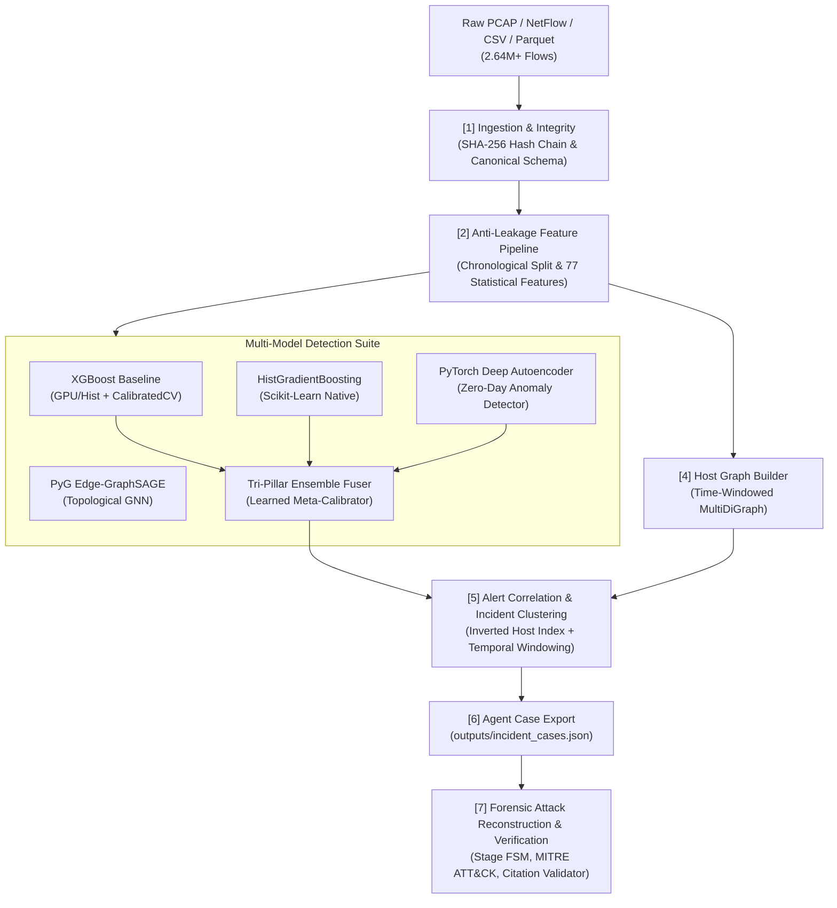

# EviGraph: Evidence-Grounded Network Forensic Framework

> **Explainable, Evidence-Grounded GNN Framework for Network Forensic Detection, Attack Reconstruction, and Verified Incident Reporting**

[](https://www.python.org/downloads/)
[](https://xgboost.readthedocs.io/)
[](https://networkx.org/)
[](https://pyg.org/)
[](LICENSE)

---

## 1. Overview & Problem Statement

Traditional AI Network Intrusion Detection Systems (NIDS) output isolated alerts and class labels without context. A cybersecurity forensic analyst needs significantly more:
* **Who attacked whom?**
* **In what sequence did stages occur?** (Reconnaissance $\to$ Initial Access $\to$ Lateral Movement $\to$ Exfiltration)
* **What raw evidence backs up the claim?**
* **Why did the detector flag this traffic?**

**EviGraph** bridges tabular machine learning, graph neural networks, and forensic reasoning agents. It turns raw network telemetry into a defensible, evidence-linked forensic case file where every finding cites immutable raw flow IDs and packet hashes.

---

## 2. System Architecture



---

## 3. Member 2 Engine: Multi-Model Detection & Graph Analytics

This repository houses the complete **Member 2 Detection & Graph Engine**, featuring a multi-model defense-in-depth architecture:

1. **Tri-Pillar Defense-in-Depth Ensemble (`src/detectors/ensemble_fuser.py` — Default):**
   * Stacks supervised gradient boosting (XGBoost + HistGB) with unsupervised deep manifold reconstruction (Autoencoder).
   * Learned meta-calibrator outputs unified posterior $[0, 1]$ risk probabilities, balancing known attack signature recognition with zero-day detection.
2. **Calibrated Baseline Detection (`src/baseline_detector.py`):**
   * Multi-class classification using XGBoost with class-balanced weighting.
   * Probability calibration via Platt scaling / `CalibratedClassifierCV` producing true risk scores $P(\text{Malicious}) = 1.0 - P(\text{BENIGN})$.
   * Strict anti-leakage isolation: IP addresses and port numbers are excluded from tabular features and retained strictly as metadata.
3. **Unsupervised Zero-Day Autoencoder (`src/detectors/autoencoder_detector.py`):**
   * Symmetric deep MLP (PyTorch, CUDA-accelerated) trained strictly on benign traffic manifolds.
   * Detects unseen zero-day exploits, evasions, and anomalous bursts via reconstruction error (MSE) spikes without requiring attack labels.
4. **Scikit-Learn Native HistGradientBoosting (`src/detectors/hist_gb_detector.py`):**
   * Fast, low-latency histogram-based gradient boosting detector optimized for rapid training and CPU environments.
5. **Inductive Graph Neural Network (`src/gnn_detector.py`):**
   * 2-layer Edge-GraphSAGE model (PyTorch Geometric) capturing topological graph context, host neighborhood degrees, and flow edge interactions.
6. **Host-Communication Graph Builder (`src/graph_engine.py`):**
   * Time-windowed directed multigraph ($Nodes = Hosts$, $Edges = Flows$).
   * Node behavioral features: in/out degrees, fan-out, fan-in, unique destination ports, bytes sent/received.
   * Bounded 1-hop suspicious subgraph extraction around alert clusters for Cytoscape.js rendering.
7. **Alert Correlation & Incident Clustering (`src/incident_cluster.py`):**
   * Scalable inverted host indexing ($O(N)$ lookup) grouping alerts sharing host entities within configurable windows ($\Delta t \le 300\text{s}$).
   * Calculates composite incident severity scores and deduces suspected patient-zero entry points.
8. **Cryptographic Merkle Evidence Ledger (`src/integrity/merkle_engine.py` — Core USP):**
   * RFC-6962 binary SHA-256 Merkle tree hashing every raw NetFlow record into tamper-evident cryptographically signed leaf digests.
   * Produces $O(\log N)$ sibling audit inclusion proofs and exports verifiable certificate `outputs/forensic_merkle_certificate.json`.
9. **Temporal Causal Provenance DAG (`src/causal_provenance.py` — Core USP):**
   * Computes a Lamport-ordered strictly monotonic causal directed acyclic graph ($t_1 < t_2$) filtering physically impossible backwards-in-time attacks.
   * Enforces a 6-stage MITRE ATT&CK progression FSM and dynamic programming topological longest-path to extract the exact Primary Attack Chain.
10. **Dual-Agent Adversarial Courtroom Cross-Examiner (`src/agent/courtroom_auditor.py` — Core USP):**
   * Ruthless automated defense auditor that cross-examines the forensic report across 4 independent gates: Cryptographic Merkle Proofs, Physical Layer-4 Protocols, Temporal Causal Monotonicity, and Telemetry Fact-Checking.
   * Issues certified verdict (`outputs/certified_forensic_verdict.json`) adhering to Federal Rules of Evidence FRE 902(13)/(14) and ISO/IEC 27037 digital forensic admissibility.
11. **Autonomous Surgical Containment & Blast-Radius Engine (`src/mitigation/countermeasure_engine.py` — Core USP):**
   * Bridges detection to active zero-downtime containment using Min-Cut bottleneck analysis on the Causal DAG.
   * Computes operational Blast-Radius impact scores and compiles multi-platform firewall rules (Linux iptables/nftables, Windows PowerShell, Cisco ACL, Cloud SG).
12. **Privacy-Preserving Redacted Proof Engine (`src/integrity/privacy_proofs.py` — Core USP):**
   * SEC Item 1.05 & GDPR Art. 33 compliant intrusion disclosure using Salted HMAC Commitments.
   * Enables third-party auditors and insurers to mathematically verify intrusion existence against the Merkle Root with 0% internal IP or subnet topology leakage.
13. **Counterfactual "What-If" Resilience Simulator (`src/simulation/counterfactual_engine.py` — Core USP):**
   * Perturbs Causal DAGs to evaluate hypothetical security controls (port blocks, microsegmentation, perimeter drop).
   * Calculates the Defensive Resilience Index (DRI) and identifies architectural Single Points of Failure (SPOF).
14. **Forensic Agent Hand-off Package:**
   * Exports serialized JSON bundles (`outputs/incident_cases.json`) linking incidents, scores, topological subgraphs, causal DAGs, and immutable Merkle root digests.

---

## 4. Repository Layout

```
.
├── .gitignore                      # Keeps raw multi-GB data & checkpoints out of git
├── main.py                         # End-to-end pipeline execution runner
├── README.md                       # Project overview & quickstart
├── PRD.md                          # Product Requirements Document
├── ARCHITECTURE.md                 # Technical Architecture & Pipeline Specification
├── DESIGN_SYSTEM.md                # UI/UX, Cytoscape Graph & Visual Design System
├── FLOW.md                         # Detailed end-to-end system & data flow specification
├── data/
│   ├── DATASET_CATALOG.md          # Complete index of raw, processed & benchmark datasets
│   ├── data_manifest.json          # Integrity hashes (SHA-256) & dataset metadata
│   ├── raw/                        # Real enterprise captures (Parquet/CSV, ignored by git)
│   ├── processed/                  # Standardized train/val/test splits (benchmark_full_340k.parquet)
│   ├── new_benchmark/              # External evaluation sets (APT-C2, DDoS2019, UNSW-NB15)
│   └── samples/                    # Small test fixtures (sample_cicids2017_flows.csv)
├── models/                         # Serialized model weights & parameters
│   ├── autoencoder_detector.pt     # PyTorch Autoencoder neural network weights
│   ├── gnn_edge_sage.pt            # PyTorch Geometric Edge-GraphSAGE weights
│   ├── ensemble_fuser.joblib       # Trained Tri-Pillar Meta-Ensemble calibrator
│   ├── hist_gb_detector.joblib     # Serialized HistGradientBoosting model
│   └── xgboost_baseline.joblib     # Serialized XGBoost baseline classifier
├── outputs/
│   ├── incident_cases.json         # Inter-agent handoff case bundle (Member 2 -> Member 3)
│   ├── forensic_incident_report.md # Generated forensic investigation report (Member 3)
│   ├── citation_validation_results.json # Verification results ensuring zero hallucination
│   ├── forensic_merkle_certificate.json # Cryptographic Merkle Root and RFC-6962 audit paths
│   ├── certified_forensic_verdict.json # Adversarial judicial verdict (FRE 902 / ISO 27037)
│   ├── courtroom_cross_examination.md # Detailed adversarial cross-examination transcript
│   ├── countermeasure_plan.json    # Machine-readable containment playbook (Min-Cut)
│   ├── incident_containment_advisory.md # Multi-platform firewall deployment advisory
│   ├── privacy_preserving_proof_certificate.json # Redacted Zero-Leakage intrusion certificate
│   ├── counterfactual_simulation_results.json # What-If resilience simulation matrix
│   └── resilience_simulation_report.md # Architectural resilience & SPOF analysis report
├── tests/
│   ├── check_ollama.py             # Ollama local runtime & tool-calling sanity check
│   ├── test_agent_rag.py           # Unit tests for ForensicAgent and CitationValidator
│   ├── test_merkle_integrity.py    # Unit tests for MerkleEvidenceEngine and tamper detection
│   ├── test_causal_provenance.py   # Unit tests for Temporal Causal DAG and Primary Attack Chain
│   ├── test_courtroom_auditor.py   # Unit tests for Dual-Agent Adversarial Courtroom Auditor
│   ├── test_countermeasure_engine.py # Unit tests for Surgical Containment & Blast-Radius Engine
│   ├── test_privacy_proofs.py      # Unit tests for Privacy-Preserving Redacted Proofs
│   └── test_counterfactual_engine.py # Unit tests for Counterfactual Resilience Simulator
└── src/
    ├── __init__.py
    ├── config.py                   # Anti-leakage metadata, features & hyperparameters
    ├── download_dataset.py         # Automated zero-auth Parquet dataset downloader
    ├── generate_sample_data.py     # Realistic synthetic multi-stage attack generator
    ├── data_loader.py              # Temporal splitting & canonical schema normalizer
    ├── baseline_detector.py        # XGBoost + CalibratedClassifierCV risk engine
    ├── gnn_detector.py             # PyTorch Geometric Edge-GraphSAGE model
    ├── graph_engine.py             # NetworkX host multigraph & subgraph extractor
    ├── incident_cluster.py         # Inverted-index alert correlation & incident builder
    ├── causal_provenance.py        # Temporal Causal Provenance DAG & Primary Attack Chain (USP)
    ├── inspect_data.py             # Quick telemetry sanity check & inspection utility
    ├── export_training_data.py     # Script to generate reproducible 340k parquet splits
    ├── generate_new_benchmark_datasets.py # Generator for multi-source benchmark suites
    ├── integrity/                  # Cryptographic Evidence Ledger & Privacy Proofs (USP)
    │   ├── __init__.py
    │   ├── merkle_engine.py        # RFC-6962 binary Merkle tree & proof generator
    │   └── privacy_proofs.py       # Privacy-preserving redacted proof-of-intrusion engine
    ├── mitigation/                 # Active Containment & Blast-Radius Engine (USP)
    │   ├── __init__.py
    │   └── countermeasure_engine.py# Graph Min-Cut & multi-platform firewall compiler
    ├── simulation/                 # Counterfactual Threat Modeling Simulator (USP)
    │   ├── __init__.py
    │   └── counterfactual_engine.py# Topological DAG perturbation & resilience index
    ├── agent/                      # Member 3 Forensic Reasoning, RAG & LLM Agent
    │   ├── __init__.py
    │   ├── citation_validator.py   # Strict Citation Validator ([E:<flow_id>] verification)
    │   ├── forensic_agent.py       # Grounded tool-calling LLM reasoning & report engine
    │   └── courtroom_auditor.py    # Dual-Agent Adversarial Courtroom Cross-Examiner (USP)
    └── detectors/                  # Specialized detector implementations
        ├── __init__.py
        ├── autoencoder_detector.py # PyTorch deep autoencoder for zero-day detection
        ├── hist_gb_detector.py     # Native HistGradientBoosting classifier
        └── ensemble_fuser.py       # Tri-Pillar Defense-in-Depth Meta-Ensemble
```

> **Note on `models/`:** Files ending in `.pt` and `.joblib` are serialized binary model checkpoints and weights. To view the human-readable code defining these models, inspect the Python source files in [`src/detectors/`](file:///c:/sahityaa/CN%20project/src/detectors/) and [`src/`](file:///c:/sahityaa/CN%20project/src/). To inspect the neural network architectures inside `.pt` files visually, use [Netron](https://netron.app/).

---

## 5. Quickstart Guide

### 1. Environment Setup
Verify you have Python 3.11+ installed. Install the dependencies:
```bash
pip install pandas numpy scikit-learn xgboost networkx pyarrow huggingface_hub
# Optional for PyTorch Autoencoder and PyG GNN:
pip install torch torch_geometric
# Or install the declared optional GNN dependencies:
pip install ".[gnn]"
```

### 2. Run Immediate Pipeline (Default: Tri-Pillar Ensemble)
Run the complete pipeline on the local multi-stage sample fixture using the ensemble:
```bash
python main.py
```
This executes feature extraction, trains the Tri-Pillar Ensemble, constructs the host graph, correlates alerts, and exports `outputs/incident_cases.json`.

### 3. Select Detector Architecture
You can choose from 5 detector architectures via `--model`:
```bash
# Tri-Pillar Meta-Ensemble (Default - XGBoost + HistGB + Autoencoder)
python main.py --model ensemble

# XGBoost Baseline Classifier
python main.py --model xgb

# Unsupervised PyTorch Deep Autoencoder (Zero-Day Anomaly Detection)
python main.py --model autoencoder

# Scikit-Learn Native HistGradientBoosting
python main.py --model histgb

# PyTorch Geometric Edge-GraphSAGE (Graph Neural Network)
python main.py --model gnn

# Use an existing, compatible GNN checkpoint without training
python main.py --model gnn --load-checkpoint
```
The GNN command trains on the training partition, uses validation data for
threshold selection, then scores only the later held-out test partition. Its
checkpoint records the feature schema, graph-window configuration, and training
time boundary; legacy checkpoints without this metadata must be retrained before
they can be used by the pipeline. Training writes `models/gnn_edge_sage.pt`.

### 4. Run on Real Big Data & Benchmarks
EviGraph provides several data loading modes via `--data`:

```bash
# 1. Run on preprocessed 340k benchmark split (Fast & Reproducible):
python main.py --data processed

# 2. Run on the full 2.64M enterprise dataset (Multi-Day CICIDS2017):
python main.py --data all

# 3. Run on external benchmark suite (APT-C2, DDoS2019, UNSW-NB15):
python main.py --data new_benchmark

### 5. Run Member 3 Forensic Agent & Citation-Validated Reporting
To run the complete pipeline and immediately invoke the downstream reasoning agent:
```bash
# Run pipeline and automatically trigger Member 3 Forensic Agent & Courtroom Cross-Examiner
python main.py --agent

# Or run the forensic agent independently on an existing case bundle
python -m src.agent.forensic_agent
```
This generates `outputs/forensic_incident_report.md` with verifiable evidence citations `[E:<flow_id>]`, and automatically invokes the **Adversarial Courtroom Cross-Examiner** to issue `outputs/certified_forensic_verdict.json`.

### ATT&CK retrieval in the dashboard API
The dashboard API stays in its saved-report demo mode by default. To opt into the
forensic agent and the existing embedding-based ATT&CK retriever, configure the
live flow and incident data before starting the API:
```powershell
$env:EVIGRAPH_AGENT_MODE = "real"
$env:EVIGRAPH_FLOWS_PATH = "data/sample/sample_flows.csv"
$env:EVIGRAPH_INCIDENTS_PATH = "data/sample/sample_incident_cases.json"
python -m uvicorn frontend.api.server:app --reload
```
The retriever uses `data/knowledge/attack_techniques.json` and the existing
`data/knowledge/attack_index.npz` embedding index. If the ignored index is not
present, start Ollama, make its `nomic-embed-text` model available, and build
the index with `python -m src.agent.attack_rag`. The API reports retrieval as
unavailable rather than substituting hardcoded techniques. Retrieved matches
are presented as evidence-linked inferences, never as confirmed behavior.

### Fresh investigation from an input file
The API accepts the formats connected to the existing ingestion pipeline:
flow CSV, flow Parquet, PCAP, and PCAPNG. PCAP input is converted into flows by
the existing streaming parser; arbitrary packet captures are not treated as
precomputed flow CSV. Flow files must include timestamps, source/destination
addresses and ports, protocol, and the feature columns required by the chosen
checkpoint. The default detector is the saved XGBoost checkpoint. Choose GNN
only with a compatible checkpoint; missing, legacy, or schema-incompatible
weights are returned as job errors, never replaced with synthetic predictions.

Run the API and Vite dashboard, then set `VITE_USE_MOCK=false` for the dashboard
to use the backend for prepared incidents. The prepared/demo selector (including
INC-0009 when present) remains a separate route; uploading a file creates a new
fresh-inference job and does not relabel demo data:
```powershell
python -m uvicorn frontend.api.server:app --reload
cd frontend
$env:VITE_USE_MOCK = "false"
npm run dev
```
Use **Input** and **Run fresh investigation** in the dashboard. The API streams
the upload to disk, hashes the original bytes, and responds with a job ID. The
dashboard polls progress without blocking the server request; completed
investigations expose normalized incidents, evidence-grounded reports, and
flow evidence lookup. Job endpoints are `POST /investigations`,
`GET /investigations/{job_id}`, `GET /investigations/{job_id}/incidents`, and
per-incident `/report` and `/evidence/{flow_id}` routes. Jobs and their artifacts
are stored in unique folders under `outputs/investigations/`. Input hashes,
flow IDs, source evidence IDs, timestamps, and detector provenance are retained;
source labels are excluded from inference.

When Ollama is unreachable, deterministic evidence-derived reports remain
available and explicitly identify the degraded reasoning status; no model-made
findings are claimed. Missing ATT&CK index status is also shown explicitly.
Verify the end-to-end contract with:
```powershell
python -m pytest tests/test_investigation_pipeline.py -q
cd frontend
npm test
```

### 6. Run Standalone Adversarial Courtroom Cross-Examiner (USP)
To independently cross-examine and audit a forensic report against Merkle proofs, Layer-4 protocols, Causal DAGs, and raw telemetry:
```bash
python -m src.agent.courtroom_auditor
```
This generates `outputs/courtroom_cross_examination.md` with FRE 902(13)/(14) & ISO/IEC 27037 legal admissibility certification.

### 7. Run Autonomous Surgical Containment & Blast-Radius Engine (USP)
To synthesize zero-downtime, multi-platform firewall containment rules (Linux iptables/nftables, Windows PowerShell, Cisco ACL) via Min-Cut bottleneck analysis:
```bash
python -m src.mitigation.countermeasure_engine
```
This generates `outputs/countermeasure_plan.json` and `outputs/incident_containment_advisory.md`.

### 8. Run Privacy-Preserving Redacted Proof Engine (USP)
To compile zero-topology-leakage intrusion certificates with Salted HMAC Commitments under SEC Item 1.05 & GDPR Art. 33:
```bash
python -m src.integrity.privacy_proofs
```
This generates `outputs/privacy_preserving_proof_certificate.json`.

### 9. Run Counterfactual "What-If" Resilience Simulator (USP)
To simulate hypothetical defense policies (port blocking, host quarantine, stage filtering) and calculate the Defensive Resilience Index (DRI):
```bash
python -m src.simulation.counterfactual_engine
```
This generates `outputs/counterfactual_simulation_results.json` and `outputs/resilience_simulation_report.md`.

### 10. Verify Ollama Connection & Run Complete Test Suite
```bash
# Check Ollama connectivity & tool calling
python tests/check_ollama.py

# Run Merkle Evidence Tree and anti-tampering unit tests
python -m unittest tests/test_merkle_integrity.py

# Run Temporal Causal Provenance DAG unit tests
python -m unittest tests/test_causal_provenance.py

# Run Dual-Agent Adversarial Courtroom Cross-Examiner unit tests
python -m unittest tests/test_courtroom_auditor.py

# Run Autonomous Surgical Containment unit tests
python -m unittest tests/test_countermeasure_engine.py

# Run Privacy-Preserving Redacted Proof unit tests
python -m unittest tests/test_privacy_proofs.py

# Run Counterfactual Resilience Simulator unit tests
python -m unittest tests/test_counterfactual_engine.py

# Run complete 32-test suite across the entire framework
python -m unittest discover -s tests
```

* **Temporal Split Only:** Never use random splits. The detection runner uses globally chronological train/validation/test partitions, so each partition starts after the previous one ends.
* **Leakage Controls:** IP addresses, MACs, and port numbers must never be features for tabular models; they are strictly metadata.
* **Traceability:** Every alert emitted by Member 2 references an immutable `flow_id` and `evidence_id`.
* **Zero-Day Resilience:** The unsupervised autoencoder complements supervised models by flagging zero-day reconstruction anomalies without prior attack signatures.
