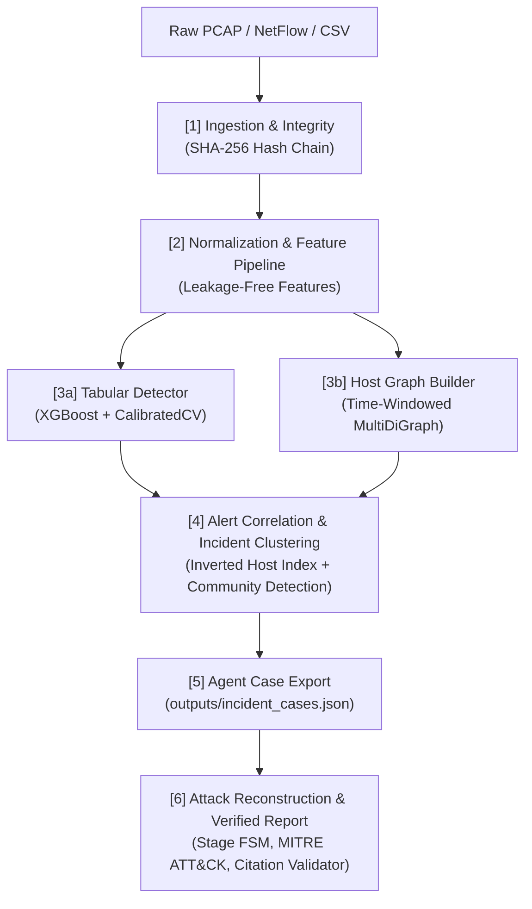

# EviGraph: Evidence-Grounded Network Forensic Framework

> **Explainable, Evidence-Grounded GNN Framework for Network Forensic Detection, Attack Reconstruction, and Verified Incident Reporting**

[](https://www.python.org/downloads/)
[](https://xgboost.readthedocs.io/)
[](https://networkx.org/)
[](https://pyg.org/)
[](LICENSE)

---

## 1. Overview & Problem Statement

Traditional AI Network Intrusion Detection Systems (NIDS) output isolated alerts and class labels without context. A cybersecurity forensic analyst needs significantly more:
* **Who attacked whom?**
* **In what sequence did stages occur?** (Reconnaissance $\to$ Initial Access $\to$ Lateral Movement $\to$ Exfiltration)
* **What raw evidence backs up the claim?**
* **Why did the detector flag this traffic?**

**EviGraph** bridges tabular machine learning, graph neural networks, and forensic reasoning agents. It turns raw network telemetry into a defensible, evidence-linked forensic case file where every finding cites immutable raw flow IDs and packet hashes.

---

## 2. System Architecture



---

## 3. Member 2 Engine: Detection & Graph Builder

This repository houses the core **Member 2 Detection & Graph Engine**, responsible for:
1. **Calibrated Baseline Detection (`src/baseline_detector.py`):**
   * Multi-class classification using XGBoost with sample class weighting.
   * Probability calibration via `CalibratedClassifierCV` (isotonic/sigmoid) producing true $[0, 1]$ risk scores.
   * Strict anti-leakage isolation: raw IPs and ports are excluded from tabular features and retained strictly as metadata.
2. **Host-Communication Graph Builder (`src/graph_engine.py`):**
   * Time-windowed directed multigraph ($Nodes = Hosts$, $Edges = Flows$).
   * Node behavioral features: in/out degrees, fan-out, fan-in, unique ports, bytes sent/received.
   * Bounded suspicious subgraph extraction around alert clusters for graph visualization.
3. **Alert Correlation & Incident Clustering (`src/incident_cluster.py`):**
   * Big-data scalable inverted host indexing.
   * Groups alerts sharing host entities within configurable time windows ($\Delta t \le 300\text{s}$).
   * Calculates incident severity scores and identifies suspected entry points.
4. **Agent Contract Exporter:**
   * Generates structured JSON packages (`outputs/incident_cases.json`) linking incidents, scores, topological subgraphs, and immutable flow evidence IDs.

---

## 4. Repository Layout

```
.
├── .gitignore                      # Keeps raw multi-GB data & checkpoints out of git
├── main.py                         # End-to-end pipeline execution runner
├── README.md                       # Project overview & quickstart
├── AGENTS.md                       # Multi-agent roles & downstream JSON contracts
├── PRD.md                          # Product Requirements Document
├── ARCHITECTURE.md                 # Technical Architecture & Pipeline Specification
├── DESIGN_SYSTEM.md                # UI/UX, Cytoscape Graph & Visual Design System
├── data/
│   ├── raw/                        # Real datasets (Parquet/CSV, ignored by git)
│   ├── processed/                  # Cleaned & normalized intermediate files
│   └── samples/                    # Small test fixtures (sample_cicids2017_flows.csv)
├── models/                         # Trained model artifacts & scalers
├── outputs/
│   └── incident_cases.json         # Agent handoff case bundle
└── src/
    ├── __init__.py
    ├── config.py                   # Anti-leakage metadata, features & hyperparameters
    ├── download_dataset.py         # Automated zero-auth Parquet dataset downloader
    ├── generate_sample_data.py     # Realistic synthetic multi-stage attack generator
    ├── data_loader.py              # Temporal splitting & canonical schema normalizer
    ├── baseline_detector.py        # XGBoost + CalibratedClassifierCV risk engine
    ├── graph_engine.py             # NetworkX host multigraph & subgraph extractor
    └── incident_cluster.py         # Inverted-index alert correlation & incident builder
```

---

## 5. Quickstart Guide

### 1. Environment Setup
Verify you have Python 3.11+ installed. The environment utilizes:
```bash
pip install pandas numpy scikit-learn xgboost networkx pyarrow huggingface_hub
# Optional for GNN extension:
pip install torch torch_geometric
```

### 2. Run the Immediate Self-Contained Test
Run the full detection and graph pipeline on the local multi-stage sample fixture:
```bash
python main.py
```
Outputs will be generated in `outputs/incident_cases.json`.

### 3. Run on Real Big Data (CICIDS2017)
Download real-world attack captures (stored in compressed Parquet in `data/raw/`):
```bash
# Download Brute Force SSH/FTP capture (445k flows, ~50 MB)
python -m src.download_dataset --day tuesday

# Download PortScan reconnaissance capture (286k flows, ~17 MB)
python -m src.download_dataset --day portscan
```

Execute the pipeline on real network data:
```bash
# Run on Tuesday Brute Force flows
python main.py --data data/raw/Tuesday-WorkingHours.pcap_ISCX.csv.parquet

# Run on a fast slice of PortScan flows (e.g. 50,000 flows)
python main.py --data data/raw/Friday-WorkingHours-Afternoon-PortScan.pcap_ISCX.csv.parquet --max-rows 50000
```

---

## 6. Evaluation Targets & Guidelines

* **Temporal Split Only:** Never use random splits. Early periods train the model; future periods evaluate generalization.
* **Leakage Controls:** IP addresses and timestamps must never be features for the tabular model.
* **Traceability:** Every alert emitted by Member 2 references an immutable `flow_id` and `evidence_id`.
