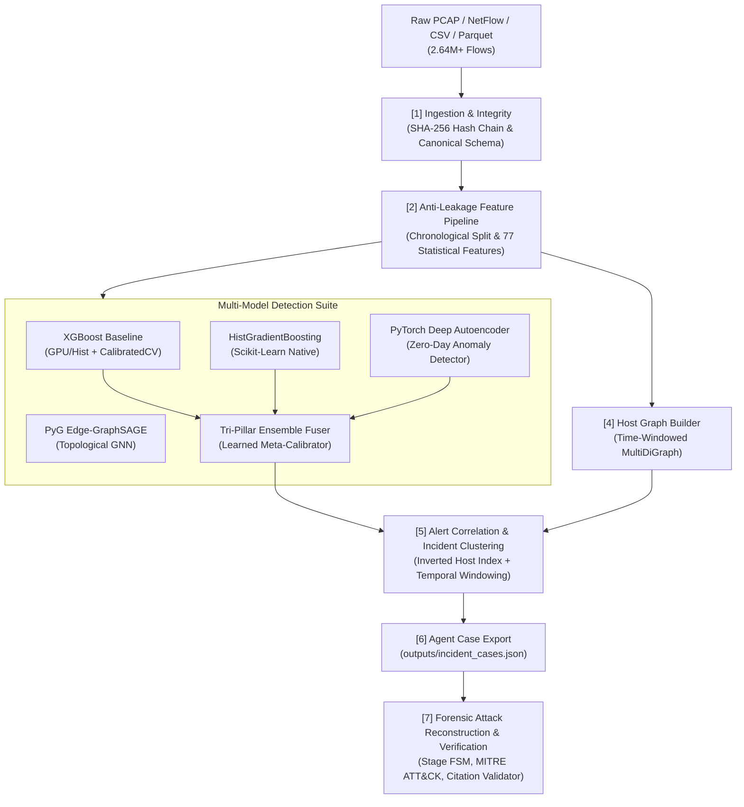

# EviGraph: Evidence-Grounded Network Forensic Framework

> **Explainable, Evidence-Grounded GNN Framework for Network Forensic Detection, Attack Reconstruction, and Verified Incident Reporting**

[](https://www.python.org/downloads/)
[](https://xgboost.readthedocs.io/)
[](https://networkx.org/)
[](https://pyg.org/)
[](LICENSE)

---

## 1. Overview & Problem Statement

Traditional AI Network Intrusion Detection Systems (NIDS) output isolated alerts and class labels without context. A cybersecurity forensic analyst needs significantly more:
* **Who attacked whom?**
* **In what sequence did stages occur?** (Reconnaissance $\to$ Initial Access $\to$ Lateral Movement $\to$ Exfiltration)
* **What raw evidence backs up the claim?**
* **Why did the detector flag this traffic?**

**EviGraph** bridges tabular machine learning, graph neural networks, and forensic reasoning agents. It turns raw network telemetry into a defensible, evidence-linked forensic case file where every finding cites immutable raw flow IDs and packet hashes.

---

## 2. System Architecture



---

## 3. Member 2 Engine: Multi-Model Detection & Graph Analytics

This repository houses the complete **Member 2 Detection & Graph Engine**, featuring a multi-model defense-in-depth architecture:

1. **Tri-Pillar Defense-in-Depth Ensemble (`src/detectors/ensemble_fuser.py` — Default):**
   * Stacks supervised gradient boosting (XGBoost + HistGB) with unsupervised deep manifold reconstruction (Autoencoder).
   * Learned meta-calibrator outputs unified posterior $[0, 1]$ risk probabilities, balancing known attack signature recognition with zero-day detection.
2. **Calibrated Baseline Detection (`src/baseline_detector.py`):**
   * Multi-class classification using XGBoost with class-balanced weighting.
   * Probability calibration via Platt scaling / `CalibratedClassifierCV` producing true risk scores $P(\text{Malicious}) = 1.0 - P(\text{BENIGN})$.
   * Strict anti-leakage isolation: IP addresses and port numbers are excluded from tabular features and retained strictly as metadata.
3. **Unsupervised Zero-Day Autoencoder (`src/detectors/autoencoder_detector.py`):**
   * Symmetric deep MLP (PyTorch, CUDA-accelerated) trained strictly on benign traffic manifolds.
   * Detects unseen zero-day exploits, evasions, and anomalous bursts via reconstruction error (MSE) spikes without requiring attack labels.
4. **Scikit-Learn Native HistGradientBoosting (`src/detectors/hist_gb_detector.py`):**
   * Fast, low-latency histogram-based gradient boosting detector optimized for rapid training and CPU environments.
5. **Inductive Graph Neural Network (`src/gnn_detector.py`):**
   * 2-layer Edge-GraphSAGE model (PyTorch Geometric) capturing topological graph context, host neighborhood degrees, and flow edge interactions.
6. **Host-Communication Graph Builder (`src/graph_engine.py`):**
   * Time-windowed directed multigraph ($Nodes = Hosts$, $Edges = Flows$).
   * Node behavioral features: in/out degrees, fan-out, fan-in, unique destination ports, bytes sent/received.
   * Bounded 1-hop suspicious subgraph extraction around alert clusters for Cytoscape.js rendering.
7. **Alert Correlation & Incident Clustering (`src/incident_cluster.py`):**
   * Scalable inverted host indexing ($O(N)$ lookup) grouping alerts sharing host entities within configurable windows ($\Delta t \le 300\text{s}$).
   * Calculates composite incident severity scores and deduces suspected patient-zero entry points.
8. **Forensic Agent Hand-off Package:**
   * Exports serialized JSON bundles (`outputs/incident_cases.json`) linking incidents, scores, topological subgraphs, and immutable flow evidence IDs.

---

## 4. Repository Layout

```
.
├── .gitignore                      # Keeps raw multi-GB data & checkpoints out of git
├── main.py                         # End-to-end pipeline execution runner
├── README.md                       # Project overview & quickstart
├── PRD.md                          # Product Requirements Document
├── ARCHITECTURE.md                 # Technical Architecture & Pipeline Specification
├── DESIGN_SYSTEM.md                # UI/UX, Cytoscape Graph & Visual Design System
├── FLOW.md                         # Detailed end-to-end system & data flow specification
├── data/
│   ├── DATASET_CATALOG.md          # Complete index of raw, processed & benchmark datasets
│   ├── data_manifest.json          # Integrity hashes (SHA-256) & dataset metadata
│   ├── raw/                        # Real enterprise captures (Parquet/CSV, ignored by git)
│   ├── processed/                  # Standardized train/val/test splits (benchmark_full_340k.parquet)
│   ├── new_benchmark/              # External evaluation sets (APT-C2, DDoS2019, UNSW-NB15)
│   └── samples/                    # Small test fixtures (sample_cicids2017_flows.csv)
├── models/                         # Serialized model weights & parameters
│   ├── autoencoder_detector.pt     # PyTorch Autoencoder neural network weights
│   ├── gnn_edge_sage.pt            # PyTorch Geometric Edge-GraphSAGE weights
│   ├── ensemble_fuser.joblib       # Trained Tri-Pillar Meta-Ensemble calibrator
│   ├── hist_gb_detector.joblib     # Serialized HistGradientBoosting model
│   └── xgboost_baseline.joblib     # Serialized XGBoost baseline classifier
├── outputs/
│   ├── incident_cases.json         # Inter-agent handoff case bundle (Member 2 -> Member 3)
│   ├── forensic_incident_report.md # Generated forensic investigation report (Member 3)
│   └── citation_validation_results.json # Verification results ensuring zero hallucination
├── tests/
│   ├── check_ollama.py             # Ollama local runtime & tool-calling sanity check
│   └── test_agent_rag.py           # Unit tests for ForensicAgent and CitationValidator
└── src/
    ├── __init__.py
    ├── config.py                   # Anti-leakage metadata, features & hyperparameters
    ├── download_dataset.py         # Automated zero-auth Parquet dataset downloader
    ├── generate_sample_data.py     # Realistic synthetic multi-stage attack generator
    ├── data_loader.py              # Temporal splitting & canonical schema normalizer
    ├── baseline_detector.py        # XGBoost + CalibratedClassifierCV risk engine
    ├── gnn_detector.py             # PyTorch Geometric Edge-GraphSAGE model
    ├── graph_engine.py             # NetworkX host multigraph & subgraph extractor
    ├── incident_cluster.py         # Inverted-index alert correlation & incident builder
    ├── inspect_data.py             # Quick telemetry sanity check & inspection utility
    ├── export_training_data.py     # Script to generate reproducible 340k parquet splits
    ├── generate_new_benchmark_datasets.py # Generator for multi-source benchmark suites
    ├── agent/                      # Member 3 Forensic Reasoning, RAG & LLM Agent
    │   ├── __init__.py
    │   ├── citation_validator.py   # Strict Citation Validator ([E:<flow_id>] verification)
    │   └── forensic_agent.py       # Grounded tool-calling LLM reasoning & report engine
    └── detectors/                  # Specialized detector implementations
        ├── __init__.py
        ├── autoencoder_detector.py # PyTorch deep autoencoder for zero-day detection
        ├── hist_gb_detector.py     # Native HistGradientBoosting classifier
        └── ensemble_fuser.py       # Tri-Pillar Defense-in-Depth Meta-Ensemble
```

> **Note on `models/`:** Files ending in `.pt` and `.joblib` are serialized binary model checkpoints and weights. To view the human-readable code defining these models, inspect the Python source files in [`src/detectors/`](file:///c:/sahityaa/CN%20project/src/detectors/) and [`src/`](file:///c:/sahityaa/CN%20project/src/). To inspect the neural network architectures inside `.pt` files visually, use [Netron](https://netron.app/).

---

## 5. Quickstart Guide

### 1. Environment Setup
Verify you have Python 3.11+ installed. Install the dependencies:
```bash
pip install pandas numpy scikit-learn xgboost networkx pyarrow huggingface_hub
# Optional for PyTorch Autoencoder and PyG GNN:
pip install torch torch_geometric
```

### 2. Run Immediate Pipeline (Default: Tri-Pillar Ensemble)
Run the complete pipeline on the local multi-stage sample fixture using the ensemble:
```bash
python main.py
```
This executes feature extraction, trains the Tri-Pillar Ensemble, constructs the host graph, correlates alerts, and exports `outputs/incident_cases.json`.

### 3. Select Detector Architecture
You can choose from 5 detector architectures via `--model`:
```bash
# Tri-Pillar Meta-Ensemble (Default - XGBoost + HistGB + Autoencoder)
python main.py --model ensemble

# XGBoost Baseline Classifier
python main.py --model xgb

# Unsupervised PyTorch Deep Autoencoder (Zero-Day Anomaly Detection)
python main.py --model autoencoder

# Scikit-Learn Native HistGradientBoosting
python main.py --model histgb

# PyTorch Geometric Edge-GraphSAGE (Graph Neural Network)
python main.py --model gnn
```

### 4. Run on Real Big Data & Benchmarks
EviGraph provides several data loading modes via `--data`:

```bash
# 1. Run on preprocessed 340k benchmark split (Fast & Reproducible):
python main.py --data processed

# 2. Run on the full 2.64M enterprise dataset (Multi-Day CICIDS2017):
python main.py --data all

# 3. Run on external benchmark suite (APT-C2, DDoS2019, UNSW-NB15):
python main.py --data new_benchmark

### 5. Run Member 3 Forensic Agent & Citation-Validated Reporting
To run the complete pipeline and immediately invoke the downstream reasoning agent:
```bash
# Run pipeline and automatically trigger Member 3 Forensic Agent
python main.py --agent

# Or run the forensic agent independently on an existing case bundle
python -m src.agent.forensic_agent
```
This generates `outputs/forensic_incident_report.md` with verifiable evidence citations `[E:<flow_id>]`, and runs `CitationValidator` to enforce $\ge 95\%$ evidence faithfulness.

### 6. Verify Ollama Connection & Run Test Suite
```bash
# Check Ollama connectivity & tool calling
python tests/check_ollama.py

# Run comprehensive unit test suite
python -m unittest tests/test_agent_rag.py
```

* **Temporal Split Only:** Never use random splits. Chronological ordering within each class ensures historical data trains the model and future traffic evaluates generalization.
* **Leakage Controls:** IP addresses, MACs, and port numbers must never be features for tabular models; they are strictly metadata.
* **Traceability:** Every alert emitted by Member 2 references an immutable `flow_id` and `evidence_id`.
* **Zero-Day Resilience:** The unsupervised autoencoder complements supervised models by flagging zero-day reconstruction anomalies without prior attack signatures.
