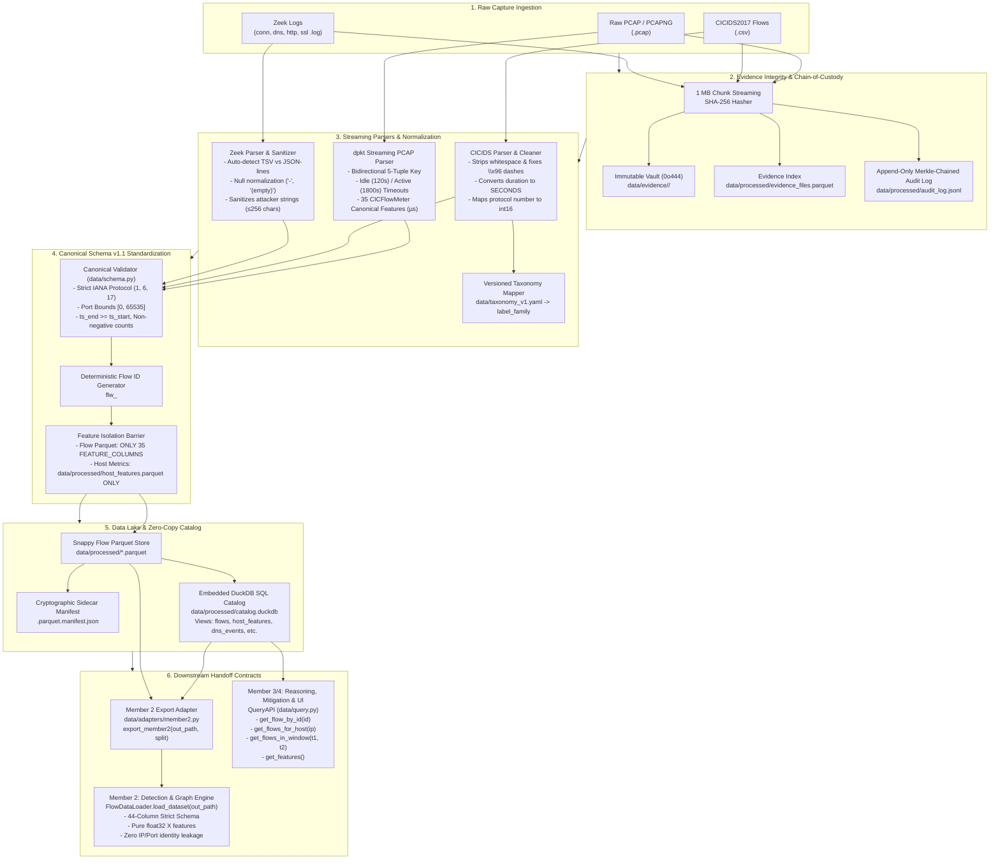

# EviGraph Member 1: Data & Traffic Pipeline Architecture

This document specifies the end-to-end data lifecycle of Member 1's **Data & Traffic Pipeline**, detailing how raw network captures are ingested, authenticated, standardized, stored, and handed off to downstream members (**Member 2: Detection & Graph Engine**, **Member 3: LLM Forensic Reasoning Agent**, and **Member 4: Mitigation & UI Engine**).

---

## 1. High-Level Architecture Diagram



---

## 2. Step-by-Step Data Flow

### Step 1: Raw Evidence Registration & Cryptographic Ledger
- **Trigger**: CLI command (`python -m data.cli ingest <file>`) or Python API (`register_evidence(path)`).
- **Process**:
  1. The raw file is read as a byte stream in **1 MB chunks**.
  2. A cryptographic **SHA-256** digest is computed while streaming.
  3. The file is copied to an immutable vault: `data/evidence/<sha256>/<original_filename>`.
  4. The copied file permissions are set to **read-only (`chmod 0o444`)**.
  5. An `EvidenceRecord` (`evidence_id = "ev_" + sha256[:12]`) is appended to `data/processed/evidence_files.parquet`.
  6. An append-only audit entry is added to `data/processed/audit_log.jsonl` using a cryptographic previous-hash link (`prev_hash` $\to$ `entry_hash`).

### Step 2: Streaming Parsing & Normalization
The pipeline auto-detects the format and routes to the dedicated streaming parser:
- **PCAP Captures (`parsers/pcap.py`)**:
  - Uses `dpkt` streaming generator (never buffers the whole PCAP into RAM).
  - Maintains a bidirectional 5-tuple lookup table (`src_ip`, `src_port`, `dst_ip`, `dst_port`, `protocol`).
  - Enforces **120s idle timeout**, **1800s active timeout**, and TCP `FIN`/`RST` state termination.
  - Computes all **35 canonical features** matching CICFlowMeter conventions (durations/IATs in $\mu s$, directional packet length statistics, TCP flags, window sizes).
  - Tolerates and counts malformed packets without crashing.
- **CICIDS2017 Captures (`parsers/cicids.py`)**:
  - Normalizes headers to lowercase snake_case.
  - Strips whitespace and fixes corrupted non-standard dash encodings (`\x96` $\to$ `-`).
  - Normalizes flow `duration` to **SECONDS** for canonical storage while preserving `feat_flow_duration` and `feat_*_iat_*` in **MICROSECONDS**.
  - Maps attack labels against versioned taxonomy (`data/taxonomy_v1.yaml`).
- **Zeek Captures (`parsers/zeek.py`)**:
  - Auto-detects TSV (#fields header) and JSON-lines formats.
  - Normalizes null markers (`"-"`, `"(empty)"`) to `None`.
  - Maps `conn.log` to canonical flows and parses `dns.log`, `http.log`, and `ssl.log` into correlated event tables joined by `zeek_uid`.
  - Sanitizes attacker-controlled string fields (caps at 256 characters and strips ASCII/C1 control characters).

### Step 3: Canonical Standardization & Anti-Leakage (Schema v1.1)
- Validated via `data/schema.py`:
  - Protocol must be numeric integer IANA values (`6 = TCP`, `17 = UDP`, `1 = ICMP`), **never strings**.
  - Port numbers strictly bounded `[0, 65535]`.
  - Temporal consistency: `ts_end >= ts_start`.
  - Non-negative packet counts, byte counts, and durations.
- Deterministic **`flow_id`** generated via `data/flow_id.py`:
  $$\text{flow\_id} = \text{"flw\_"} + \text{sha256}(\text{evidence\_sha256} \mid \text{src\_ip} \mid \text{src\_port} \mid \text{dst\_ip} \mid \text{dst\_port} \mid \text{protocol} \mid \text{ts\_start\_ns} \mid \text{occurrence\_idx})[:16]$$
- **Feature Isolation**: Host-level graph metrics (`in_degree`, `out_degree`, `fan_out`, `total_bytes`) are isolated into `data/processed/host_features.parquet` and are **strictly excluded** from flow tables.

### Step 4: Storage & Analytical Cataloging
- **Parquet Storage (`data/storage.py`)**:
  - Writes Snappy-compressed, columnar Parquet tables to `data/processed/`.
  - Generates a cryptographic sidecar manifest `<name>.manifest.json` containing row count, column list, and file SHA-256.
- **DuckDB SQL Catalog (`DuckDBCatalog`)**:
  - Creates zero-copy views over the Parquet store (`flows`, `host_features`, `dns_events`, `http_events`, `tls_events`).
  - Enables sub-second analytical querying across millions of flows without memory duplication.

---

## 3. How Downstream Members Consume the Data

### A. Member 2: Detection & Graph Engine
Member 2 consumes datasets exported by the dedicated adapter [`data/adapters/member2.py`](file:///c:/coding/college/CN Project/Evigraph/data/adapters/member2.py).

#### 1. Generating Member 2's Dataset:
```python
from data.adapters import export_member2

# Export all flows or a specific split into Member 2's benchmark parquet
export_member2("data/processed/benchmark_flows.parquet")
```

#### 2. Exact Column Contract (44 Columns):
Member 2 requires **exactly 44 columns** in this order:
1. `flow_id` (str)
2. `evidence_id` (str)
3. `timestamp` (tz-naive UTC `datetime64[ns]`)
4. `src_ip` (str)
5. `dst_ip` (str)
6. `src_port` (int32)
7. `dst_port` (int32)
8. `protocol` (int16)
9. `label` (str, with `"BENIGN"` standardized)
10–44. **35 Canonical Flow Features** (unprefixed `float32`, guaranteed 0 `NaN`/`Inf`):
   - `flow_duration`, `tot_fwd_pkts`, `tot_bwd_pkts`, `tot_len_fwd_pkts`, `tot_len_bwd_pkts`
   - `fwd_pkt_len_max`, `fwd_pkt_len_min`, `fwd_pkt_len_mean`, `fwd_pkt_len_std`
   - `bwd_pkt_len_max`, `bwd_pkt_len_min`, `bwd_pkt_len_mean`, `bwd_pkt_len_std`
   - `flow_bytes_s`, `flow_pkts_s`
   - `flow_iat_mean`, `flow_iat_std`, `flow_iat_max`, `flow_iat_min`
   - `fwd_iat_tot`, `bwd_iat_tot`
   - `fwd_psh_flags`, `bwd_psh_flags`, `fwd_urg_flags`, `bwd_urg_flags`
   - `fin_flag_cnt`, `syn_flag_cnt`, `rst_flag_cnt`, `psh_flag_cnt`, `ack_flag_cnt`, `urg_flag_cnt`
   - `down_up_ratio`, `pkt_size_avg`, `init_fwd_win_byts`, `init_bwd_win_byts`

#### 3. How Member 2 Ingests the Dataset:
Member 2 uses their existing `FlowDataLoader` without modification:
```python
from pathlib import Path
from src.data_loader import FlowDataLoader

loader = FlowDataLoader()
df = loader.load_dataset(Path("data/processed/benchmark_flows.parquet"))

# Temporal train / val / test split
(
    X_train, y_train, meta_train,
    X_val, y_val, meta_val,
    X_test, y_test, meta_test
) = loader.prepare_temporal_split(df)
```
- `X_train`, `X_val`, `X_test` contain **exclusively the 35 flow features** (zero IP, port, or timestamp identity leakage).
- `meta_train`, `meta_val`, `meta_test` contain `flow_id`, `timestamp`, `src_ip`, `dst_ip`, `src_port`, `dst_port`, `protocol`, and `evidence_id` for graph construction.

---

### B. Member 3 & Member 4: LLM Forensic Reasoning Agent & Mitigation UI
Members 3 and 4 access telemetry through the public [`QueryAPI`](file:///c:/coding/college/CN Project/Evigraph/data/query.py):

```python
from data.query import QueryAPI

api = QueryAPI()

# 1. Forensic flow lookup by unique ID
flow = api.get_flow_by_id("flw_abc1234567890def")

# 2. Host communication history (for Blast Radius & Graph traversal)
host_flows = api.get_flows_for_host("192.168.10.5", limit=500)

# 3. Direct communications between attacker and victim
pivot_flows = api.get_flows_between("192.168.10.5", "10.0.0.1")

# 4. Temporal window query (for incident timeline reconstruction)
window_flows = api.get_flows_in_window("2026-10-18T10:00:00", "2026-10-18T10:05:00")

# 5. Model feature matrix (guarantees reading FEATURE_COLUMNS only, zero host leakage)
X_features = api.get_features(limit=1000, unprefixed=True)

# 6. Arbitrary zero-copy DuckDB SQL analytics
stats = api.execute_sql("""
    SELECT label, COUNT(*) AS count, AVG(duration) AS avg_duration
    FROM flows
    GROUP BY label
""")
```

---

## 4. Integrity Verification & Audit Command

At any time, anyone on the team can run a full cryptographic verification to prove that zero raw evidence files or audit log records have been modified:

```bash
python -m data.cli verify
# or
evigraph-data verify
```
**Output**:
```
PASS: Evidence integrity and audit log hash chain are 100% verified.
```
If a single byte in any registered raw file or in `audit_log.jsonl` is altered, the command exits with code 1 and outputs an `IntegrityError` specifying the exact file and expected vs actual SHA-256 digest.
